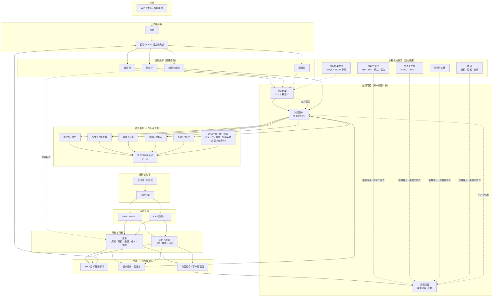
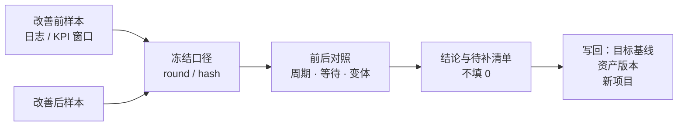
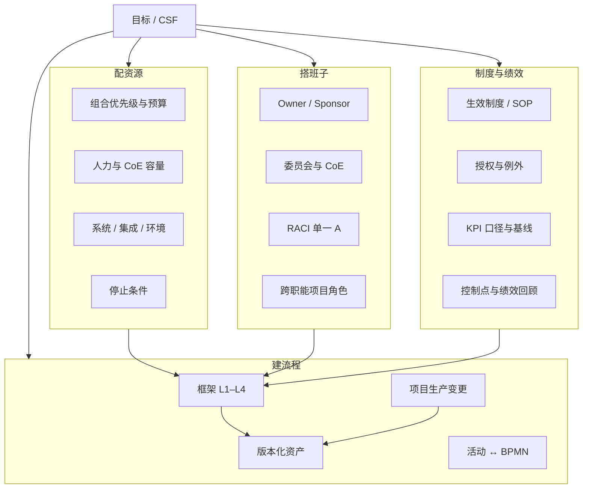

# 企业管理体系图谱（修订版）

> **状态：** 治理与产品对齐用的参考图谱，不是「已全部实现」声明。  
> **评审结论（2026-11-08）：** 采纳为 Logix 的企业管理体系结构基准；评审提出的 5 处修订已并入，实现状态以 §11 为准。  
> **原则对齐：** [bpm-product-principles.md](bpm-product-principles.md)、[enterprise-process-strategy-loop.md](enterprise-process-strategy-loop.md)。  
> **与旧图差异：** 补客户与反馈回路；区分流程框架 / 资产 / 项目；区分「活动工具」与「方法论」；治理与证据横切全栈。  
> **产品映射：** 文末附 Logix 模块对照；未列能力以主线矩阵与代码为准。

---

## 1. 一条总原则

**流程不是目的，是让战略与客户结果可控的一种实践。**  
目标分解为四路并行使能；流程与制度绩效是其中两路，必须与资源、组织同频，并通过度量与证据形成闭环。

---

## 2. 完整结构图（主链 + 双回路）



**横切（图中未单独成框，贯穿 L2–L7）：**

- **流程治理：** 版本、审批、权限、例外、审计、影响分析。  
- **追溯矩阵：** 目标 ↔ 流程 L3 ↔ L4 活动 ↔ KPI ↔ 控制点。  
- **证据契约：** 完成 ≠ 打勾；须有可指向的记录/版本/样本。

---

## 3. 承接矩阵（补齐「目标 → 建流程」单向箭头）

| 关系 | 必须能回答的问题 | 最佳实践要点 | 常见反模式 |
|------|------------------|--------------|------------|
| 客户 → 战略 | 谁买单、什么结果算赢、哪些约束不可破 | 客户结果一行话；合规/安全/质量红线单独列出 | 只写内部效率口号 |
| 战略 → 目标 | 今年要动哪几个杠杆 | CSF + 可测目标 + 基线 + 责任人 + 来源依据 | 只有目标值无基线 |
| 目标 → L3 流程 | 哪条流程对哪个目标 **主责承接** | 每条关键目标至少一条主承接流程；次要支撑标 `SUPPORTING` | 目标挂在 L1 却不落到 L3 |
| 目标 / KPI → L4 活动 | 哪个活动对哪个指标 **有解释力** | KPI 可选绑 `activity_id`；活动变更做影响提示 | KPI 只有流程级，无法找瓶颈 |
| 改流程 | 影响哪些目标/KPI/制度 | 变更单带「影响目标」清单；评审看组合重复收益 | 改模型不通知战略 Owner |
| 度量 → 目标 | 改善是否足以改基线或目标 | 冻结口径前后对照；达标须有权核验，不单凭项目结项 | 项目完成即宣称战略达成 |

---

## 4. 三层过程对象（纠正「框架—资产—项目」三角并列）

```text
流程框架（Framework）
  定义：L1–L4 目录、类型、边界、Owner 锚点、PCF/SCOR 参照映射
  生命周期：长期；ID 稳定；删除/合并要走变更

流程资产（Assets）
  定义：挂在某 process_id 上的版本化内容
  含：模型版本、SOP、表单、规则、RACI 快照、控制点说明、KPI 定义（口径）
  不含：方法论工具本身、项目台账、活动工具（作业资源/接口）

流程项目（Projects）
  定义：一轮改善的变更容器（识别→运营五阶段）
  产出：修改资产或新增版本；结项归档，不替代长期流程对象
  关系：Project → process_id；薄轮次固定当次模型/样本/结论引用
```

**项目不是资产。** 图上若画成三者对等互指，容易让实施方把「项目文件夹」当成「流程仓库」。

---

## 5. 目标分解四路：最佳实践（配全）

> **实现状态标记：** `已有` = 产品可操作；`部分` = 有对象/接口但未闭环；`待补` = 未实现。  
> 下表列的是 **落点参考**，不是「已全部可用」声明；总览见 §11。

四路与「建流程」并行，缺任一路都会导致流程题做了却不落地。

### 5.1 配资源（Resource）

**要回答：** 谁出钱、谁出人、谁出系统容量、改善节奏是否与组合一致。

| 维度 | 最佳实践 | 交付/证据（应能点开） | Logix 落点（参考） |
|------|----------|------------------------|-------------------|
| 组合与预算 | 年度改善组合有优先级上限；单项目有估算工时/费用与 Sponsor 批复 | 项目卡预算字段、组合视图、阶段门 | `projects`、驾驶舱 |
| 人力容量 | 关键流程有 Owner 时间承诺；CoE/试点有显式 FTE 或外包合同 | 岗位、工作量标准、产能日历 | `orgs`、`workload` |
| 系统与集成 | ERP/OA/数据接口有责任人与环境；试点先沙箱 | 集成配置、出站/入站 Webhook、RPA 登记 | `integrations`、十层登记 |
| 方法与模板 | 模板/标准文件有生效版本，不临时用邮件附件 | 交付物库、标准文件继承 | `deliverables` |
| 风险与停止条件 | 资源不到位可暂停或缩范围；停止条件写进章程 | 项目停止条件、Pilot 层记录 | 章程、项目 |

**门禁口诀：** 没有 Sponsor 资源批复、没有 Owner 时间承诺、没有环境就绪 → 不进入大规模试点。

---

### 5.2 搭班子（Team / Governance）

**要回答：** 谁对结果负责、谁有权拍板、谁提供方法、跨部门怎么协同。

| 维度 | 最佳实践 | 交付/证据 | Logix 落点（参考） |
|------|----------|-----------|-------------------|
| 结果责任 | 每条关键 L3 一个 **Process Owner（人，不是部门）** | `owner_user_id`、治理角色 | `map`、`orgs` |
| 发起与赞助 | 改善项目有 Sponsor；重大变更上委员会/经营层 | Sponsor 字段、COMMITTEE 角色 | `projects`、RACI |
| CoE / 流程管理科 | 标准、工具、评审、数据口径；不抢业务 Owner 收益权 | BPM_OFFICE 角色、模板库 | `toolbox`、授权 |
| RACI | 关键事项 **有且只有一个 A**；R/C/I 可多个 | 设计器 RACI、非法多 A 校验 | `designer`、RACI 服务 |
| 跨职能交付 | 项目步骤有责任/接收人；冲突有升级路径 | ProjectStep、交接 ToolSheet | `workflow` 工作台 |
| 任期与代理 | Owner 离岗有代理与复核；不长期「挂名」 | 组织政策（系统记任命版本） | 章程、授权 |

**门禁口诀：** Owner 是账号、Sponsor 缺席、RACI 无 A → 不算「班子搭好」。

---

### 5.3 建流程（Process）

**要回答：** 范围清晰、资产可版本、活动能映射执行、项目只负责改一版。

| 阶段 | 最佳实践 | 交付/证据 | Logix 落点（参考） |
|------|----------|-----------|-------------------|
| 定界 | 一条 L3 起止、不做什么；端到端 SIPOC | 章程、十层第 2 层 | `pilot`、流程卡 |
| 架构 | L1–L4 齐；PCF 映射有据，不替代企业目录 | 地图、`benchmark_map` | `map`、`pcf` |
| 现状 | As-Is 模型冻结；活动 ↔ BPMN `node_key` | 模型版本、`NodeActivityLink` | `designer`、`asset_graph` |
| 诊断 | 问题—样本—损失—根因；**compiled 报告**（如 R1） | ToolSheet + 报告交付物版本 | 分析页、R1 编译（2.1–2.4 门禁） |
| 设计 | To-Be 比较与控制；设计接收 ≠ 上线 | 冻结工作版、设计 ToolSheet | M4、设计器 |
| 上线 | 发布 + 运行配置 + 准备确认 + 实例 | 执行配置、实例快照 | `execution` |
| 运营 | KPI 口径固定；异常闭环 | KPI、异常、改善项目 | `monitor`、M7 |

**活动层关键：** L4 活动 ID 与 BPMN 节点可映射；否则 KPI、表单、工时三套挂不到同一活动。

**编译链目标（产品方向）：** 方法论输入 → **产物组装** → 可验收资产版本，而不是只登记「填过表」。

---

### 5.4 制度与绩效（System & Performance）

**边界先钉死：** 制度/授权落到资产与治理；绩效口径落到 KPI 定义（资产），绩效数据落到 L7 度量。
不把 KPI 记录再算成一条流程资产，也不让「制度」与「绩效」各建一套流程对象。

**要回答：** 制度是否生效、绩效是否可测、控制点是否执行、绩效是否与目标同口径。

| 维度 | 最佳实践 | 交付/证据 | Logix 落点（参考） |
|------|----------|-----------|-------------------|
| 制度体系 | L1–L4 标准文件有层级、归属组织、变体策略 | 标准文件、生效版本 | `deliverables` |
| 授权与例外 | 审批路径、例外路径、所需证据字段齐全 | 授权规则、例外台账 | `authorization` |
| KPI 口径 | 公式、单位、源事件、日历、样本规则先定义后取数 | `KpiDefinition.measurement` | `monitor` |
| 基线与目标 | 战略 KPI 与流程 KPI 可追溯；改基线有权核验 | 目标—流程—KPI 链 | `strategy` |
| 控制点 | 关键控制写在模型/制度/规则，不单在口头 | 规则、控制点资产包项 | `asset_graph` |
| 绩效回顾 | 红黄指标→异常→行动→效果核验→是否立项 | 异常闭环、Gate | M7、项目 |
| 个人绩效边界 | 流程 KPI 不直接等于个人考核；须组织政策 | 产品只提供事实与责任链 | 原则文档 §3.3 |

**门禁口诀：** 制度未生效、KPI 无口径、无样本仍报绿 → 不算「制度与绩效就位」。

---

## 6. 两类「工具」——避免图谱混层

| 名称 | 含义 | 在图谱中的位置 | 典型例子 |
|------|------|----------------|----------|
| **方法论工具** | 分析/设计时产生证据与资产草稿 | 支持体系 · 流程方法论 & 方法论工具 | SIPOC、VSM、5Why |
| **活动工具** | 执行活动时所需的资源与接口 | 作业资源层 · 与具体活动并列（不是版本化资产） | 量具、MES 工位、OA 表单、ERP 事务码 |

方法论工具 **不是** 流程资产；活动工具 **也不是** SOP 正文，而是「活动靠什么完成」的引用。

Logix 现状提示：`tool` 表承载方法论；`NodeTool` 绑的是方法编码（设计证据）。**活动工具** 更应落在表单/规则/集成/标准文件与 L4 描述上，不宜与 33 个方法工具共表展示。

---

## 7. 从活动到信息化（方向校正）

```text
具体作业与活动（内容与责任）
        ↓ 被编排
工作流 / 审批流（控制流语义）
        ↓ 落地
执行引擎实例与任务
        ↓ 集成
ERP / OA（事务与记录系统）
```

不是「活动指向 ERP」，而是 **活动定义内容**，**工作流编排顺序与权责**，**ERP/OA 记帐与回写**。

---

## 8. 反馈回路（产品最该补的一段）



最佳实践：

1. 同一 `process_id` + 明确 `round_id`（或等价对照键）。  
2. 改善前/后两次导入或两次取样 **口径一致**；不一致则阻断「达标」断言。  
3. 结论挂 **交付物版本** 或 Gate 引用，不单是项目状态 `DONE`。  
4. 战略复盘可读「流程对目标的贡献说明」，不要求系统证明因果。
5. 阶段门只在**结构化声明「依据改善对照」**时强制可比/样本/接收条件；自由文本里的改善断言不解析，
   不能把它当作已核验结论。

---

## 9. 治理横切清单（不是最底一排框）

| 机制 | 贯穿位置 | 最佳实践 |
|------|----------|----------|
| 版本与生效 | 资产、制度、模型、表单 | 未发布不冒充运行；生效日、审批人可查 |
| 权限与职责 | 写操作、本人核验、Separation | 指定非编辑者确认；403/409 保留输入 |
| 审计 | 关键对象变更 | 谁何时改了什么；敏感字段前后值 |
| 影响分析 | 变更模型/规则 | 提示目标/KPI/在用实例 |
| 证据 | 阶段门、四结论、培训操作 | 缺项显式待补；来源数量 ≠ 通过 |

---

## 10. 与 Logix 产品导航的读法（给人用，不给图加模块）

| 图谱层 | 建议用户路径 |
|--------|----------------|
| 战略/目标 | 体系总览 → 战略目标 → 承接流程 |
| 目标/流程反查 | 追溯矩阵：目标/KPI → L3/L4 → 节点 → 资产版本 → 证据 |
| 配资源/搭班子 | 组织与人员、授权、项目组合立项 |
| 建流程（公司） | 体系总览 → 企业流程地图 |
| 建流程（一条） | 十层核对 → 设计器 → 执行 |
| 制度/授权 | 交付物、授权矩阵 |
| 绩效口径 | KPI 定义、流程分析 |
| 改善项目 | 项目组合 → `#workflow` 工作台 |
| 方法论 | 方法论工具箱 / 步骤契约中的工具链 |
| 反馈 | 流程卡、薄轮次对照、异常与 KPI（KPI 基线写回与阶段门引用已有；资产基线/轮次待补） |

**不要** 把八阶段导航当成必须 1→8 做完的楼梯；它是 **长期流程上的模块地图**。

---

## 11. 实施优先级与实现状态

### 11.1 优先级

1. **诊断竖切**：2.1–2.4 → 《诊断报告 R1》编译为资产版本。**（已完成：`r1-readiness` / `r1/compile` / `r1`；必填输入未齐只出草稿）**  
2. **追溯矩阵只读面**：目标—L3—L4—KPI 可反查，消费 R1 资产版本。**（已完成：`/traceability`；只读，缺链接显示「未承接」）**  
3. **双样本反馈**：同口径前后对照写回 KPI 基线/目标与阶段门。**（只读对照、接收门禁、KPI 基线/目标写回与阶段门引用已完成；资产基线与轮次写回待补）**  
4. **四路门禁文案**：立项/阶段门显式检查资源、班子、制度字段，不单查流程图。

> 先做 R1，是因为它先证明「Sheet/模型 → 资产版本」的编译链；
> 矩阵随后可以直接消费 R1 版本，不用再造临时视图。

### 11.2 实现状态

| 能力 | 状态 |
|------|------|
| 架构 L1–L4、模型版本、资产包 | 已有 |
| 客户/市场要求 → 目标承接 | 已有（结构化要求对象；可挂多个目标） |
| 目标 → 流程/KPI 四路使能就绪度 | 已有（配资源/搭班子/建流程/制度与绩效；缺口可跳转） |
| 活动身份 L4 ↔ BPMN、证据账本 | 已有 |
| 文档候选活动、CSV 日志导入 | 已有（人工确认/映射） |
| 目标—L3—L4—KPI 追溯矩阵 | 已有（只读矩阵；含资产版本与证据反查） |
| 2.1–2.4 → R1 编译 | 已有（SIPOC/VSM/5Why 门禁；草稿与提交评审分开） |
| 双样本只读对照（两次日志比较） | 已有（同口径/映射/模型校验；对照本身不自动写回，写回是独立动作） |
| 对照接收与改善宣称门禁 | 已有（可比 + 两次单量 ≥5 + 人工接收；记录依据与审计） |
| KPI 基线/目标写回 | 已有（仅月频流程级时长 KPI；基线取改善后均值，目标须人填；KPI 版本 +1） |
| 阶段门引用改善对照 | 已有（可比 + 样本 ≥5 + 已接收；引用失效阻止阶段推进） |
| 写回资产基线/轮次 | 待补 |
| 活动工具一等对象 | 待补 |

---

## 12. 文档维护

- 旧培训/九步叙述以 [training-zero-to-one.md](training-zero-to-one.md) 为操作脚本，以 **本文图谱** 为结构基准。  
- 若图谱与 [startup-path.md](startup-path.md) 冲突，**以本文与 product-principles 为准**，startup-path 历史段落仅作对照。  
- 改图谱先改本节 Mermaid，再决定是否同步帮助中心 `help/catalog`。

---

## 附录 A：目标分解四路关系图



---

## 附录 B：名词对照

| 中文 | 英文参考 | 备注 |
|------|----------|------|
| 流程框架 | Process Framework | 目录与 ID |
| 流程资产 | Process Assets | 版本化内容 |
| 流程项目 | Process Improvement Project | 五阶段，非 BPM 实例 |
| 活动工具 | Activity / Job tools | 非方法论 |
| 方法论工具 | Method tools | 支持体系 |
| 追溯矩阵 | Traceability matrix | 目标—流程—活动—KPI |
| 编译链 | Compile pipeline | Sheet/模型 → 报告/SOP 版本 |
